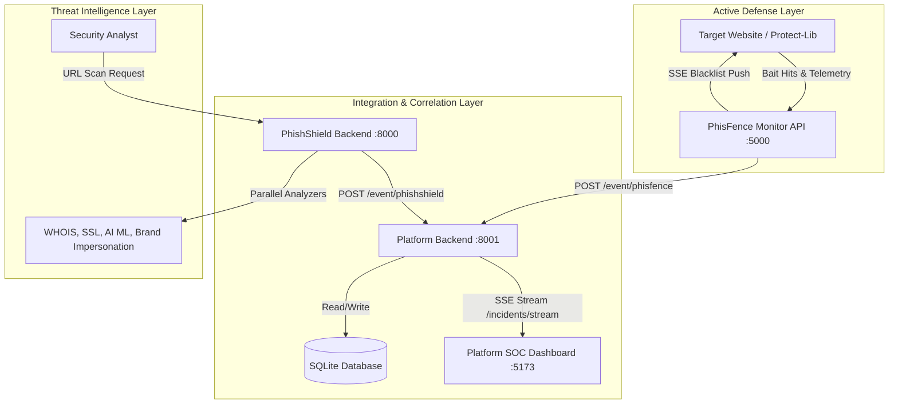

# System Architecture

The **Phishing Defense Platform** is an enterprise-grade threat management system that correlates active deception signals from **PhisFence** with machine-learning threat assessments from **PhishShield**.

